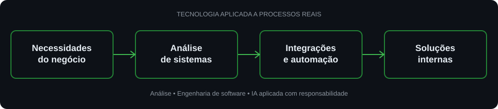

# Fabrício Castro

**Analista de Sistemas · Desenvolvedor Front-end / Full Stack**  
*React · Next.js · TypeScript · NestJS · Integrações e automação com IA*

São Paulo, Brasil

---

## Sobre mim

Sou **Analista de Sistemas na [Morina](https://morinaoficial.com.br/)**, onde atuo há aproximadamente dois anos no desenvolvimento de soluções internas para apoiar a operação da empresa, otimizar processos e integrar informações e ferramentas.

Minha atuação combina **análise de necessidades do negócio, desenvolvimento de software, automação e integração de inteligência artificial**. Procuro identificar problemas recorrentes e propor soluções tecnológicas sustentáveis, com atenção à manutenção, à confiabilidade e à utilidade para as pessoas que utilizam os sistemas.

Tenho também experiência profissional no desenvolvimento de interfaces para uma plataforma LMS na Wikitec Tecnologia e uma trajetória anterior em infraestrutura, suporte técnico e gestão operacional. Essa combinação me ajuda a compreender tanto a implementação quanto o contexto real de uso das soluções.

Meu foco técnico inclui React, Next.js, TypeScript, NestJS e PostgreSQL, além de arquitetura modular, design systems e aplicações empresariais.

## Experiência atual

### Analista de Sistemas · [Morina](https://morinaoficial.com.br/)

**Atuação atual · aproximadamente 2 anos**

- Analiso necessidades e fluxos de trabalho para identificar oportunidades de melhoria nos processos internos.
- Desenvolvo e aprimoro soluções utilizadas internamente, buscando reduzir atividades manuais e retrabalho.
- Trabalho na integração de sistemas, informações e ferramentas para apoiar a continuidade dos processos.
- Exploro e aplico automação e inteligência artificial a problemas concretos do ambiente operacional.
- Contribuo com propostas de inovação tecnológica, avaliando a viabilidade e a manutenção das soluções.

Meu compromisso é **transformar necessidades operacionais em soluções úteis, integradas e responsáveis**, sem confundir inovação com complexidade desnecessária.

  

## Fé e propósito

**Minha fé em Deus é o fundamento da minha vida.** Nele encontro meu Pai, meu mentor e a força que me sustentou nos momentos mais difíceis. Tenho profunda gratidão por Seu amor e Sua misericórdia; reconheço que é pela graça de Deus que hoje posso exercer a profissão de desenvolvedor. Procuro honrá-Lo também no meu trabalho, com dedicação, integridade e responsabilidade.

## Tecnologias

| Área | Tecnologias e práticas |
| --- | --- |
| **Front-end** | JavaScript, TypeScript, React, Next.js, HTML, CSS, Tailwind CSS |
| **Back-end** | Node.js, NestJS, APIs REST, Prisma |
| **Dados** | PostgreSQL |
| **Ferramentas** | Git, GitHub, Docker, Vercel |
| **Engenharia** | Design systems, arquitetura modular, DDD, acessibilidade e testes |

> Esta lista reúne tecnologias utilizadas em projetos e áreas de estudo. Não representa certificações ou domínio avançado de todas elas.

## Projetos selecionados

### [Portfólio profissional](https://fanpage-puce.vercel.app/)

Apresentação dos meus trabalhos, experiências e interesses em desenvolvimento de software, com atenção à identidade visual e experiência de navegação.

**[Ver site](https://fanpage-puce.vercel.app/)** · [LinkedIn](https://www.linkedin.com/in/fabriciofcastro/)

### [Galtec Engenharia — website institucional](https://github.com/fabriciofcastro/galtec-website)

Projeto de website corporativo com foco em interface responsiva, organização de conteúdo, acessibilidade e SEO.

**[Ver repositório](https://github.com/fabriciofcastro/galtec-website)**

### ERP/CRM e sistemas empresariais

Estudos e desenvolvimento de soluções com arquitetura modular, organização de domínios, gerenciamento de permissões e automação de processos. Alguns projetos podem ter acesso restrito por envolverem trabalho privado.

## Como trabalho

- **Requisitos antes de implementação:** entender o problema, os usuários e as restrições.
- **Qualidade por construção:** componentes reutilizáveis, revisão de código e testes adequados.
- **Arquitetura proporcional ao problema:** evitar complexidade sem justificativa técnica.
- **Evolução contínua:** documentar decisões e melhorar o produto de forma incremental.

## Contato

Para oportunidades profissionais, colaboração ou projetos:

**[Conecte-se comigo no LinkedIn](https://www.linkedin.com/in/fabriciofcastro/)** · **[Explore meus repositórios](https://github.com/fabriciofcastro?tab=repositories)**

---

Construindo software com propósito, consistência e atenção aos detalhes. 🇧🇷

